# 点线 · 使用手册

用浏览器打开下面这个链接即可：

```text
https://dotline-3g343as.maozi.io
```

数据默认只存在**本机浏览器**，每人互不影响。

---

## 一、电脑端

- 顶部输入框写待办 → 选日期 → **添加**（待办可以跨日期）
- **双击**任务：完成 / 取消
- 底部：**脉络**（时间线）/ **今日**（当天待办列表）

<p align="center">
  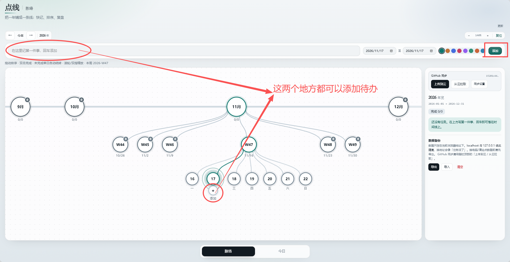
</p>

---

## 二、手机端

- 单指拖、双指捏缩放；也可用右上角 **− / +**
- **往下滑页面**才能看到同步、导出（别只在白块时间轴里滑）

<p align="center">
  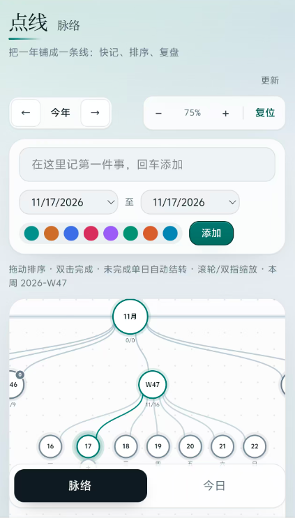
</p>

---

## 三、电脑 ↔ 手机同步（可选）

不同步也能用。要两边一致：用**自己的** GitHub Token + Gist（别共用别人的）。

### ① 申请 Token（一次）

GitHub → Settings → Developer settings → Personal access tokens → **Classic** → 勾选 **gist** → 生成并复制（`ghp_` 开头）

<p align="center">
  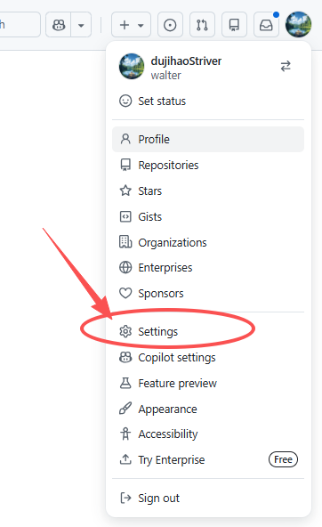
</p>

<p align="center">
  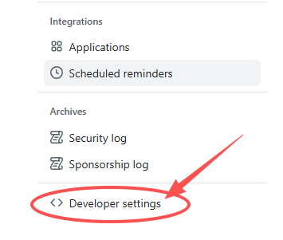
</p>

<p align="center">
  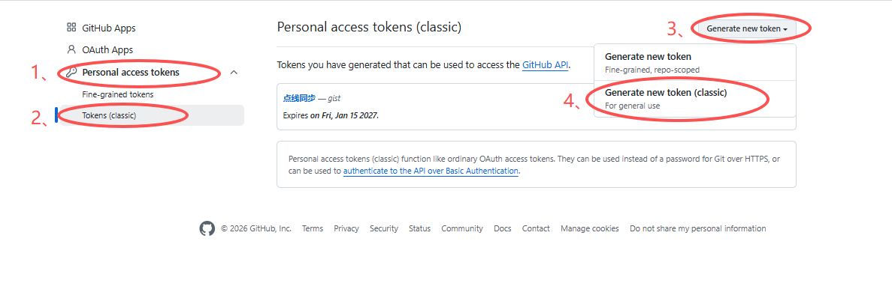
</p>

<p align="center">
  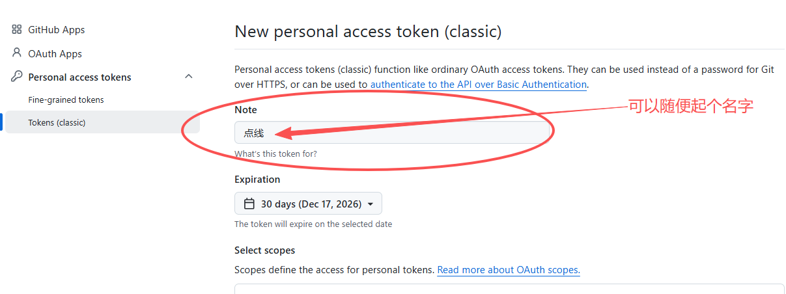
</p>

<p align="center">
  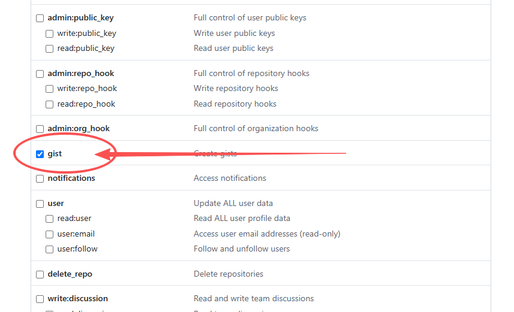
</p>

<p align="center">
  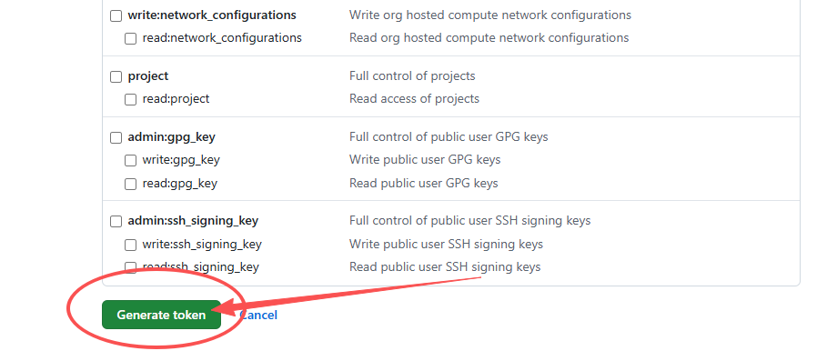
</p>

### ！！！一定要复制这个 token（下次就没了）

<p align="center">
  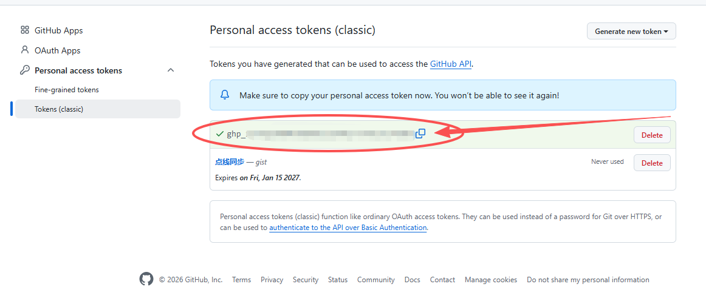
</p>

### ② 电脑上传

点线右侧 **GitHub 同步** → 填 Token（Gist ID 先空）→ **上传到云** → 复制生成的 **Gist ID**

<p align="center">
  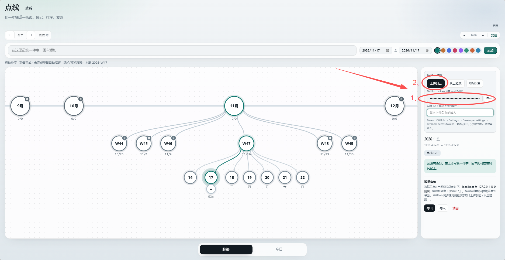
</p>

<p align="center">
  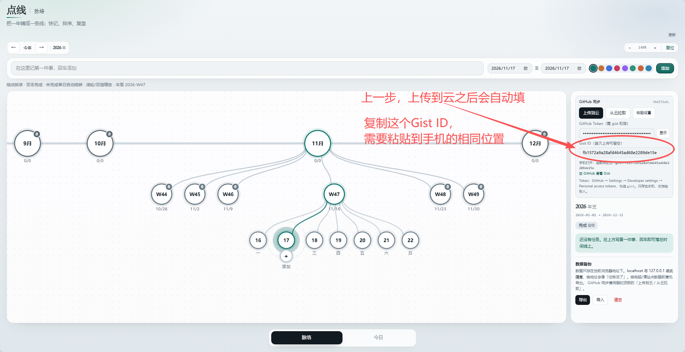
</p>

### ③ 手机拉取

填同一 Token + Gist ID → **从云拉取**

以后：改完的那台 **上传**，另一台 **拉取**（拉取会覆盖本机）。

---

## 四、备份

侧栏 **导出** 下载备份；换机前先导出。`localhost` 和正式网址是两套数据。

### 手机端导出

<p align="center">
  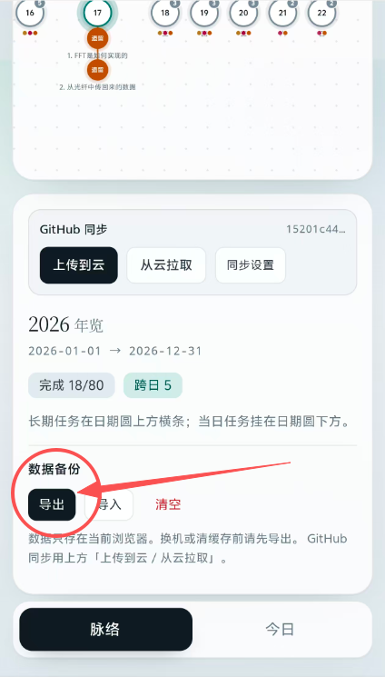
</p>

### 电脑端导出

<p align="center">
  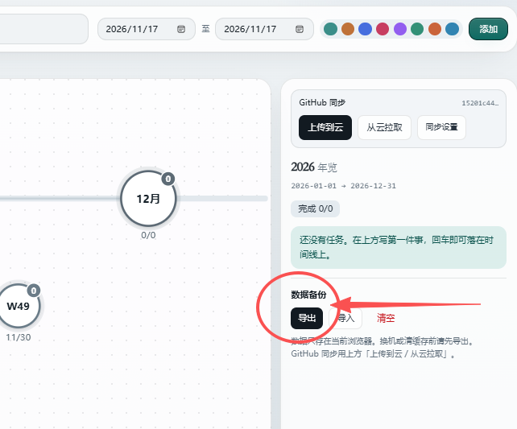
</p>

---

## ！！！注意

- Token 当密码，别发群
- 拉取后没有新任务 → 先确认电脑是否已上传、两边 ID 是否一致
